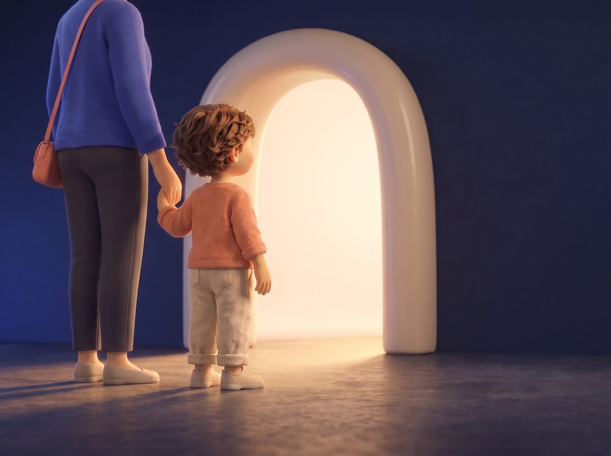
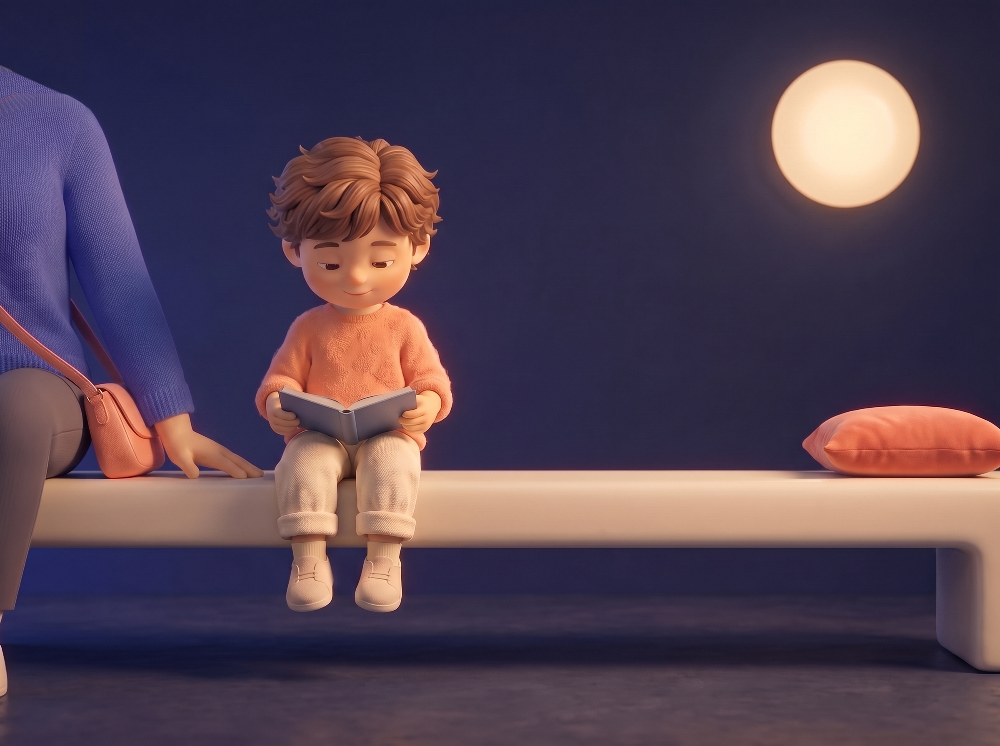
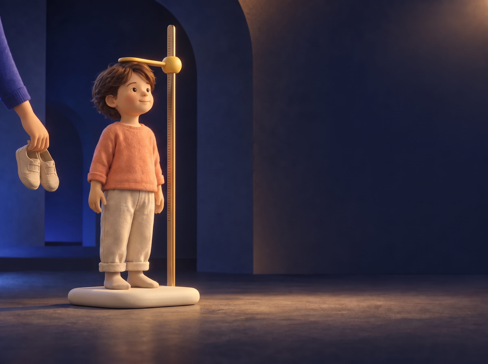
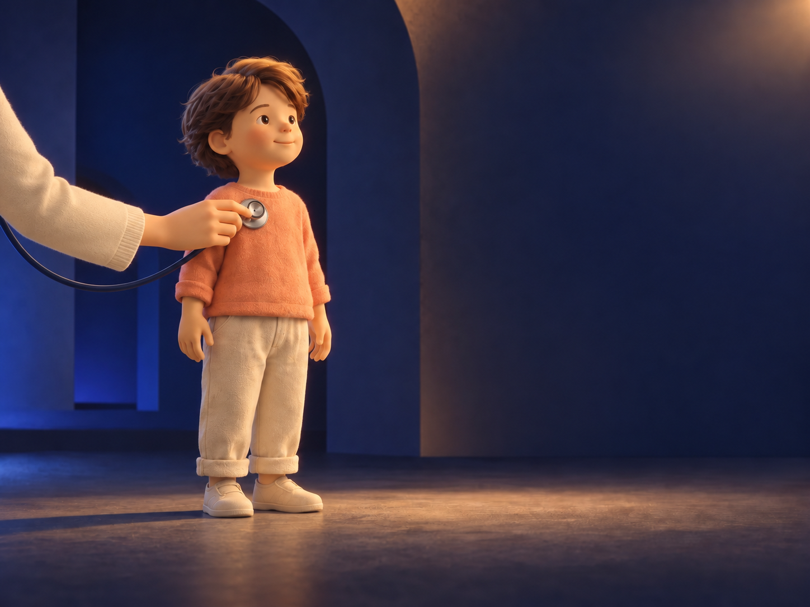
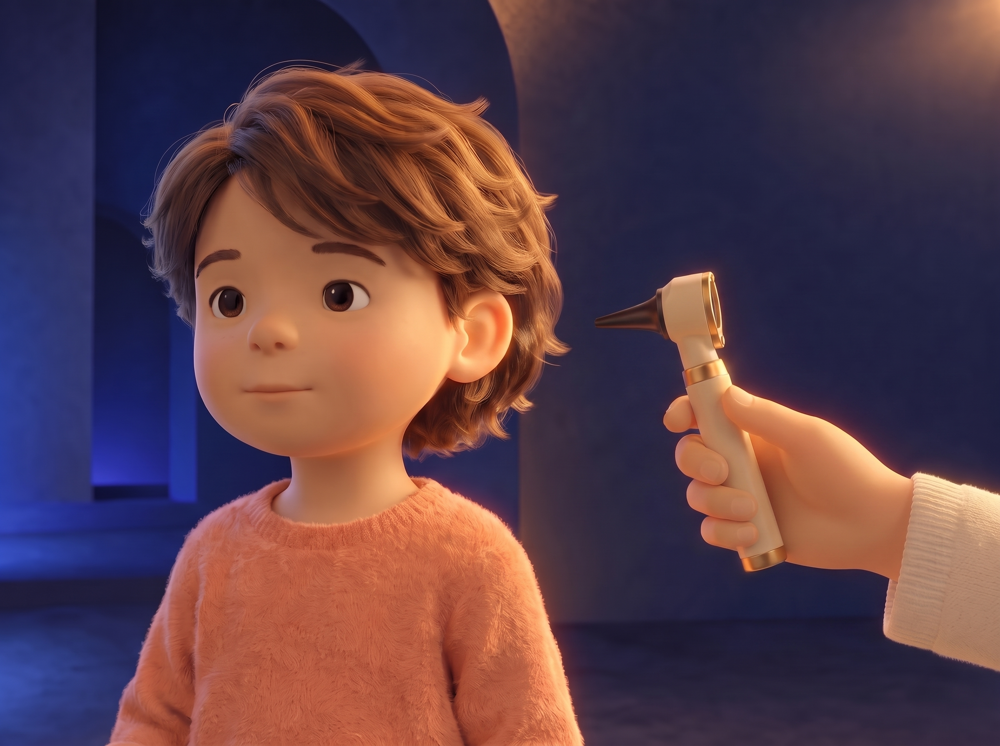
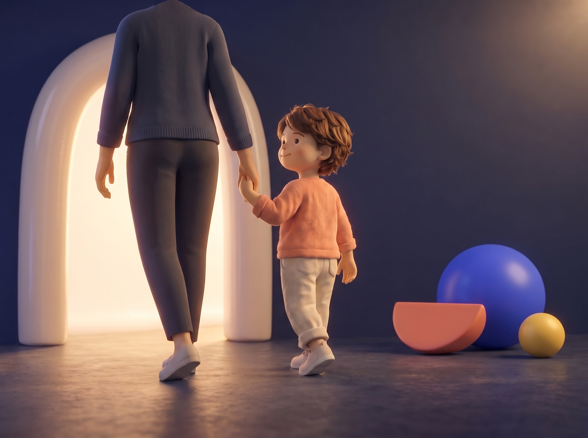

# Freigabepaket „Mein Arztbesuch“ (ENTDECKEN)

Stand: 2026-10-12 · Bildstand: Commit `0f46783` · Bildquellen: [docs/design/discovery-reference/](../design/discovery-reference/README.md)

## Worum es geht

„Mein Arztbesuch“ ist das erste Kapitel im Kinderbereich ENTDECKEN. Sechs kurze Szenen zeigen einem Kind (ca. 3–7 Jahre), wie ein Arztbesuch ablaufen **kann**: von der Ankunft bis zum Nachhausegehen. Eltern lesen die kurzen Sätze vor; die Bilder erzählen mit. Einleitung für Eltern auf der Seite: „So kann ein Arztbesuch aussehen. Nicht jeder Besuch läuft genau so ab – manches entfällt, manches kommt dazu.“

**Stand:** Die **Bilder sind fertig, visuell freigegeben und in die Website eingebaut**. Die formalen Freigaben sind **offen**, das Kapitel ist **nicht veröffentlicht**. Ohne Vorschau-Parameter steht dort „In Vorbereitung“. Das fertige Kapitel lässt sich in der Staging-Vorschau prüfen: `/entdecken/mein-arztbesuch?vorschau=freigabe`, oder über `/entdecken?vorschau=freigabe` → „Mein Arztbesuch“.

Bevor das Kapitel erscheinen darf, braucht es vier **getrennte** Entscheidungen:

| Freigabe | Wer | Umfang | Formular |
|---|---|---|---|
| Visuell | Projekt / Art Direction | alle 6 Szenen | ✅ erledigt (2026-10-07 bis 2026-10-12) |
| Praxis | Praxisteam | alle 6 Szenen: passt das zu Besuchen bei uns? | [Praxis- & Inhaltsprüfung](discovery-practice-content-review.md) |
| Inhalt / Redaktion | Praxis bzw. Redaktion | alle 6 Szenen: Text und Bild verständlich, ruhig, ohne falsche Versprechen | [Praxis- & Inhaltsprüfung](discovery-practice-content-review.md) |
| Ärztlich | Ärztin | nur Szenen **03, 04, 05** (medizinische Inhalte) | [Ärztliche Prüfung](discovery-physician-review.md) |
| Veröffentlichung KI-Kind | Praxisleitung | eine Entscheidung für alle Szenen | [Entscheidung KI-Kind](discovery-ai-child-publication-decision.md) |

**Wichtig für alle Prüfenden:** Die Bilder zeigen eine **erfundene, symbolische Bühne**. Sie zeigen **nicht** die Praxisräume, den Eingang, das Wartezimmer, das Team oder echte Patientinnen und Patienten. Das Kind ist eine KI-generierte Figur. Die Begleitperson ist ein Elternteil, und es ist nie ein Gesicht zu sehen. Von der Ärztin sind nur Hand und Ärmel zu sehen.

## Übersicht der sechs Szenen

| # | Szene | Visuell | Praxis | Inhalt | Ärztlich |
|---|---|---|---|---|---|
| 01 | Ankommen | ✅ freigegeben | offen | offen | nicht nötig |
| 02 | Warten | ✅ freigegeben | offen | offen | nicht nötig |
| 03 | Messen & Wiegen | ✅ freigegeben (Stilreferenz) | offen | offen | **erforderlich** |
| 04 | Abhören | ✅ freigegeben | offen | offen | **erforderlich** |
| 05 | Ohren & Hals | ✅ freigegeben (korrigierte Fassung) | offen | offen | **erforderlich** |
| 06 | Fertig | ✅ freigegeben (korrigierte Fassung) | offen | offen | nicht nötig |

Diese Zuordnung entspricht dem Datenmodell (`src/content/discovery.ts`): Nur die Szenen 03–05 haben ein Feld für die ärztliche Freigabe. Alle Freigaben stehen dort auf `TO_BE_CONFIRMED`.

---

### 01 · Ankommen

- **Botschaft:** „Wir kommen an.“ Das Kind kommt an der Hand einer Begleitperson an und geht hinein.
- **Text auf der Seite:** „Wir sind da. / Wir gehen hinein und sagen Hallo. / Jetzt beginnt der Besuch.“ · Für Eltern: „Erzählen Sie Ihrem Kind ruhig vorher, wer mitkommt und wie Sie zur Praxis kommen.“
- **Bild:** Kind und Begleitperson (Hand in Hand, von hinten) vor einem hell leuchtenden Keramikbogen. **Der Bogen ist symbolisch, nicht der echte Eingang.**
- **Akzeptierte Abweichungen:** Die Haare sind etwas lockiger als in der Stilreferenz; der Bogen steht etwas mittiger als geplant.
- **Prüffragen:** Wirkt der Einstieg ruhig und einladend? Passt die Beziehung zur Begleitperson? Entsteht nirgends der Eindruck, das sei der echte Eingang?
- **Datei:** `d1-01-ankommen-v1.png`

### 02 · Warten

- **Botschaft:** „Warten gehört manchmal dazu.“
- **Text:** „Manchmal wartet man ein bisschen, bis man dran ist. / Warten gehört dazu.“ · Für Eltern: „Ein Buch oder ein Lieblingsspielzeug von zu Hause kann beim Warten helfen.“
- **Bild:** Das Kind sitzt ruhig mit einem Buch auf einer langen hellen Bank; die Begleitperson sitzt angeschnitten daneben. **Bank, Kissen, Buch und Lichtscheibe sind symbolisch, nicht das echte Wartezimmer.**
- **Akzeptierte Abweichungen:** Der Kopf des Kindes wirkt etwas größer und spielzeughafter; die Lichtscheibe kann an einen Mond erinnern.
- **Prüffragen:** Wirkt das Warten ruhig statt lästig? Passt der Elterntipp („Buch von zu Hause“) zur Praxis, etwa wenn es dort Spielsachen gibt oder nicht?
- **Datei:** `d1-02-warten-v1.png`

### 03 · Messen & Wiegen — *ärztliche Prüfung*

- **Botschaft:** Messen (und Wiegen) kann zum Besuch gehören; so sieht man, wie ein Kind wächst.
- **Text:** „Manchmal wird geschaut, wie groß du gerade bist. / Und wie schwer. / Dafür gibt es einen Messstab und eine Waage.“ · Warum: „So sieht man, wie ein Kind wächst.“
- **Bild:** Ein Messstab aus Messing mit Strichen ohne Zahlen, eine gelbe Markierung auf Kopfhöhe, ein flacher Keramiksockel. Das Kind steht in Socken, die Begleitperson hält die Schuhe.
- **Hinweis:** Das Bild zeigt vor allem das Messen. Die Waage ist nur als flacher Sockel ohne Anzeige angedeutet; der Text erwähnt sie ausdrücklich.
- **Prüffragen:** Ist der Ablauf plausibel (Socken, Schuhe aus)? Ist etwas am Messen irreführend? Passt der Text zu Kindern, die in der Praxis anders gemessen oder gewogen werden, etwa Säuglinge liegend?
- **Datei:** `d1-03-messen-wiegen-styleframe-v1.png`

### 04 · Abhören — *ärztliche Prüfung*

- **Botschaft:** Die Ärztin kann mit dem Stethoskop hören, wie Herz und Atmung klingen.
- **Text:** „Die Ärztin hat ein Stethoskop. / Damit kann sie hören, wie dein Herz und deine Atmung klingen. / Das Stethoskop kann sich etwas kühl anfühlen.“ · Warum: „Herz und Lunge machen Geräusche. Mit dem Stethoskop kann man sie gut hören.“
- **Bild:** Das Kind ist vollständig bekleidet; das Bruststück liegt **auf dem Pullover**. Zu sehen ist nur eine Erwachsenenhand mit hellem Ärmel; kein Gesicht, keine Symbole.
- **Akzeptierte Abweichungen:** Der Ausschnitt ist weiter als geplant; die Hand kommt von links; das Kind schaut nach vorn statt auf das Bruststück; das Bruststück ist **silbern** statt kobaltblau mit Messingrand.
- **Herkunft:** Erstellt mit ChatGPT-Bildgenerierung (die anderen Szenen mit Higgsfield).
- **Prüffragen:** Ist das Abhören über dem Pullover als Darstellung vertretbar, oder weckt es eine falsche Erwartung, weil in der Praxis meist auf der Haut abgehört wird? Ist die Position plausibel? Passt „kann sich etwas kühl anfühlen“ zum Bild?
- **Datei:** `d1-04-abhoeren-v1.png`

### 05 · Ohren & Hals — *ärztliche Prüfung*

- **Botschaft:** Mit einer kleinen Lampe kann die Ärztin ins Ohr schauen. **Das Bild zeigt nur das Ohr**; der Hals steht nur im Text.
- **Text:** „Mit einer kleinen Lampe kann die Ärztin in deine Ohren schauen. / Manchmal schaut sie auch in deinen Hals. / Dafür machst du den Mund weit auf.“ · Warum: „Mit dem Licht kann man sehen, wie es im Ohr aussieht.“
- **Bild:** Ein Otoskop (heller Griff, Messingringe, dunkle Spitze) wird von rechts gehalten. Die Spitze ist **deutlich außerhalb des Ohrs**, mit sichtbarem Abstand. Das Kind wirkt ruhig. Keine Ansicht ins Ohr, kein Rachen, nur eine Hand, kein Gesicht.
- **Akzeptierte Abweichung:** An der Spitze ist kein Licht zu sehen.
- **Prüffragen:** Ist das Otoskop erkennbar und plausibel? Ist der Abstand zum Ohr in Ordnung, also „gleich wird geschaut“? Stören Handhaltung oder Instrument? Ist es in Ordnung, dass der Hals nur im Text vorkommt?
- **Datei:** `d1-05-ohren-hals-v1.png`

### 06 · Fertig

- **Botschaft:** „Geschafft. Jetzt weißt du ein bisschen besser, wie ein Arztbesuch aussehen kann.“
- **Text:** „Geschafft. / Jetzt weißt du ein bisschen besser, wie ein Arztbesuch aussehen kann. / Jeder Besuch ist ein bisschen anders.“ · Für Eltern: „Wenn Ihr Kind Fragen hat, nehmen Sie sie mit in die Praxis – dort kann man sie in Ruhe beantworten.“
- **Bild:** Kind und Begleitperson gehen Hand in Hand zum selben Bogen wie in Szene 01 zurück; das Kind blickt kurz zurück. Die Begleitperson trägt dunkle Kleidung, ihr Kopf ist nicht im Bild. Rechts liegen drei ENTDECKEN-Formen (Kugel in Kobaltblau, Halbscheibe in Koralle, Kugel in Gelb). Es gibt keine Belohnung und keine Behandlungsspuren.
- **Akzeptierte Abweichungen:** Die Begleitperson wirkt dominanter als geplant; die kobaltblaue Kugel ist größer; die Formen liegen eng beieinander; die Bewegung ist ruhiger; das Licht ist etwas kühler; die Haare sind etwas voller.
- **Prüffragen:** Ist der Abschluss ruhig und beruhigend, ohne „Belohnung“? Passt „Jeder Besuch ist ein bisschen anders“ als Schlusssatz?
- **Datei:** `d1-06-fertig-v1.png`

---

## Herkunft (Kurzfassung)

Alle Szenenbilder sind als `AI_CONCEPTUAL` eingestuft. Sie zeigen keine realen Personen und keine realen Räume.
- **Szenen 01, 02, 03, 05, 06:** Higgsfield · Nano Banana Pro · 2400 × 1792.
- **Szene 04:** ChatGPT-Bildgenerierung · 1448 × 1086.
- **Lokale Retuschen** (Bildbearbeitung, keine KI-Generierung): Szene 02 oben links, Szene 06 oben.

Details, Job-IDs und SHA-256-Prüfsummen stehen in [discovery-reference/README.md](../design/discovery-reference/README.md).

Hinweis: Die **echten Gemälde** im Startseiten-Hero sind ein **anderes Thema** mit eigenen offenen Fragen (Rechte des Malers, Einwilligung). Sie gehören nicht zu diesem Paket.

## Was nach den Freigaben passiert

Die Bilder sind bereits für die Website aufbereitet (`public/discovery/`, ohne Hochskalierung) und eingebaut. Sobald die Freigaben mit Namen und Datum vorliegen, werden sie in `src/content/discovery.ts` eingetragen und das Kapitel durch eine bewusste Änderung an `RELEASE.meinArztbesuchApproved` geöffnet. Bis dahin bleibt es gesperrt.
